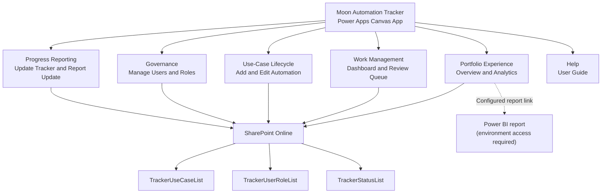

# Moon Automation Tracker

### Automation Portfolio, Use-Case Governance & Progress Monitoring | Microsoft Power Platform

Moon Automation Tracker is a Power Apps Canvas application designed to centralize the submission, review, governance and monitoring of automation use cases. It gives teams a shared view of the automation pipeline, supports structured use-case reviews, manages user roles and captures ongoing progress updates.

The solution brings automation portfolio visibility and day-to-day tracking into one workspace through dashboards, searchable records, review forms and status-update experiences.

## App Gallery

The supplied screenshot document contains the following key experiences:

- Landing and portfolio overview
- Automation dashboard and advanced filters
- Review queue and multi-step review
- New automation submission
- User-role administration
- Update Tracker and Report New Update
- User Guide

> Add the exported screenshots to the `Screenshots/` folders described in [Project Files & Resources](#08-project-files--resources), then replace the suggested image paths below with the committed image paths.

---

## 01. Project Overview

| Item | Details |
|---|---|
| Application name | Moon Automation Tracker (AutoTrack) |
| Application type | Microsoft Power Apps Canvas App |
| Business domain | Automation governance, portfolio management and operational reporting |
| Primary purpose | Centralize automation use cases, reviews, ownership, status updates and portfolio visibility |
| Intended users | Automation teams, automation leads, reviewers and users responsible for maintaining automation records |
| Interface | Desktop / tablet, landscape |
| Canvas dimensions | 1366 × 768 |
| Data platform identified in app | SharePoint |
| Project status | Developed Canvas App; production deployment status is not established by the supplied files |

### What the application does

Moon Automation Tracker provides a common workspace to:

- View automation portfolio metrics and use-case distribution.
- Search, filter and review automation use cases.
- Submit new automation use cases through a structured form.
- Review use cases across multiple information areas before completing a review.
- Maintain user-to-role assignments.
- Capture current status, challenges/dependencies, planned actions and support requirements.
- Submit report updates and review previous update history.
- Explore automation guidance through an in-app User Guide.
- Navigate to supporting analytics/reporting through a configured report link.

### Application modules

| Module | Purpose |
|---|---|
| Home / Landing | Entry point with navigation to Overview, Dashboard and Add Automation |
| Overview | Portfolio-level metrics and visual summaries |
| Analytics | Analytics-focused view of automation data |
| Dashboard | Searchable automation use-case register with filters and actions |
| Review Queue | Review and update submitted use cases |
| Add Automation | Create a new automation use case |
| Manage Users | Assign and maintain application roles |
| Update Tracker | Record progress, challenges, actions and support needs |
| Report Update | Submit a new update against a selected use case |
| User Guide | In-app instructions and usage guidance |

---

## 02. Business Problem & Objective

### Business problem

Automation initiatives can involve many use cases at different stages, with different owners, teams, product streams, automation types and delivery timelines. When this information is maintained across disconnected trackers or communicated through separate updates, it becomes harder to maintain a consistent portfolio view.

Teams need to know which use cases are planned, in progress, live, on hold or awaiting review. Reviewers also need structured information before a use case can move forward, while leads need visibility into blockers, dependencies, planned actions and support requirements.

### Previous / manual process

The supplied application files do not document a formal before-state process or measured baseline. The operational challenges the app is designed to address include:

- Maintaining automation use-case information in a consistent structure.
- Finding records across a growing portfolio.
- Tracking changes in status and planned go-live timelines.
- Coordinating reviews and recording review outcomes.
- Keeping ownership and team information current.
- Collecting progress updates, blockers and support requests.
- Preparing a consolidated view of portfolio health for stakeholders.

These points describe the process needs addressed by the application; they should not be interpreted as measured claims about a specific previous system.

### Why an application was needed

A dedicated application provides a structured record for each use case and a shared interface for portfolio monitoring. It reduces dependence on unstructured status communication by bringing use-case information, review stages, user roles and progress updates into a single application experience.

### Application objectives

1. Establish a centralized automation use-case register.
2. Provide a portfolio overview through summary metrics and visual analytics.
3. Enable users to search and filter use cases using relevant business attributes.
4. Standardize the creation of new automation use cases.
5. Support a structured review process before a use case progresses.
6. Make role assignment and user administration manageable within the app.
7. Capture dated status updates, challenges, planned actions and support requirements.
8. Improve visibility of the automation pipeline and its current state.
9. Provide users with in-app guidance for common activities.

---

## 03. Key Features & Functionality

### 3.1 Automation portfolio overview

The Overview screen presents a consolidated view of the automation portfolio.

Visible dashboard metrics include:

- Total use cases.
- Live use cases.
- Ongoing use cases.
- Pipeline use cases.
- On-hold use cases.
- Retired use cases.

The screen also includes visual summaries such as:

- Use cases by product stream.
- Use cases by automation type.
- A report/analytics entry point.

The screenshots show portfolio filters such as **Overall**, **AI** and **Non-AI**.

### 3.2 Automation dashboard and use-case register

The Dashboard screen provides a searchable and filterable register of automation use cases.

Visible capabilities include:

- Search by use-case identifier or title.
- Filter by scope.
- Filter by contract.
- Filter by team.
- Filter by status.
- Open additional filters.
- Reset filter selections.
- View use-case attributes in a tabular layout.
- Access record-level actions.

The expanded filter panel shown in the screenshots includes:

- Product Stream
- Product Group
- Cluster
- Category
- Sub Category
- Ownership
- Automation Type
- Automation Level

The register displays fields such as UCID, Use Case Title, Scope, Contract, Stream, Team and Status.

### 3.3 Add a new automation use case

The Add Automation screen uses a multi-tab / staged form to capture the information needed to register a new use case.

The visible information areas are:

- **Use Case:** Scope, Contract, Product Stream, Product Group, Domain and E2E Process.
- **Automation:** Automation-related classification and details.
- **Impact:** Impact-related information.
- **Ownership:** Ownership and team-related information.
- **Timeline:** Planned Timeline, Go-Live Date, Identified On, Status and Comments.

The screenshots show required-field indicators on several fields and a final Submit action. The exact validation rules should be confirmed against the form formulas and the connected SharePoint column configuration before being documented as a complete validation specification.

### 3.4 Review queue and review workflow

The Review Queue presents use cases for review and provides a staged review experience.

The screenshots show:

- A review dashboard with searchable/filterable use cases.
- A visual indicator for records requiring review.
- A multi-section review form.
- Navigation between review sections using Previous and Next.
- A final Complete Review action.

The review sections shown are:

1. Use Case
2. Automation
3. Impact
4. Ownership
5. Timeline

The Timeline section includes fields such as Identified On, Go-Live Date, Planned Timeline, Status and Comments. The screenshots also show a Previous Comments interaction, allowing reviewers to refer to earlier context while reviewing a record.

The application package contains form submission and notification logic. The actual approval authority, decision matrix and any downstream workflow actions should be validated in the target environment; the screenshots alone do not establish a separate Power Automate approval flow.

### 3.5 User-role management

The Manage Users screen provides a user-role administration workspace.

Visible capabilities include:

- View configured users and their email addresses.
- Filter users by resource.
- Filter users by role.
- Add a user.
- Edit an existing user-role assignment.
- Remove a user-role assignment.
- Review an access preview for the selected role.

The screenshot examples show role labels including **Automation Team** and **Automation Lead**. The exact permission matrix and enforcement rules should be confirmed in the deployed application and data-source permissions.

### 3.6 Update Tracker

The Update Tracker screen captures ongoing progress information for an existing use case.

Visible capabilities include:

- Search for a use case.
- Filter by update category.
- Filter by date.
- Open an existing update for editing.
- Select the relevant use case.
- Record the update date and category.
- Expand sections for:
  - Current status details
  - Challenges / Dependencies
  - Action Planned
  - Support Required
- Refer to previous updates where available.
- Submit the update.

This structure helps maintain a dated history of progress and the issues that may affect delivery.

### 3.7 Report New Update

The Report Update screen provides a form to submit a new progress update.

The screenshots show fields for:

- Use Case Title
- Date
- Category
- Current status details
- Challenges / Dependencies
- Action Planned
- Support Required

The Use Case Title field is presented as a selectable list, helping associate the update with an existing automation record.

### 3.8 User Guide

The User Guide screen provides in-app help through expandable sections.

The visible topics include:

1. Who Can Use the Application?
2. Navigation
3. Creating a New Use Case
4. Reviewing a Use Case
5. Updating a Use Case
6. Tool Features
7. Tips
8. Need Help?

This reduces the need for users to rely on separate instructions for common application tasks.

### 3.9 User roles and permissions

| Role shown in the supplied materials | Context |
|---|---|
| Automation Team | Role option visible in the user-role dashboard |
| Automation Lead | Role option visible in the user-role dashboard |

The app initializes the signed-in user and looks up the user's role from the `TrackerUserRoleList` data source. The source also contains role-aware UI logic. The complete role-to-screen/action permission matrix is not established by the supplied package and should be documented after checking the deployed configuration.

### 3.10 Search, filters and notifications

- Search and dropdown filters are used to narrow use-case and user records.
- Additional filters are available from a dedicated filter panel.
- Reset actions are available in the filtering experience.
- `Notify()` is used in the Power Fx source for user-facing feedback.
- Form submission patterns are present in the add, review, user-role and update experiences.

The supplied `.msapp` does not include the definitions of external notification flows. Therefore, email or automated notification delivery should not be claimed unless the corresponding cloud flow is separately verified.

---

## 04. Screenshots & User Interface

The supplied Word document contains 15 pages of screenshots. The following index maps the main application experiences to their locations in that document.

| Screen / experience | What it demonstrates | Source document |
|---|---|---|
| Landing screen | Automation Tracker branding and navigation to Overview, Dashboard and Add Automation | Page 1 |
| Overview screen | Portfolio KPI cards, product-stream distribution, automation-type chart and report entry point | Page 1 |
| Automation dashboard | Use-case register, search, filters, status and row-level actions | Pages 2–3 |
| Advanced filters | Expanded filter drawer and no-results state | Page 3 |
| Review dashboard | Review queue, review indicators and expanded filters | Pages 4–5 |
| Review form | Multi-section review across Use Case, Automation, Impact, Ownership and Timeline | Pages 5–7 |
| Add Automation | Staged form for use-case information and timeline submission | Page 8 |
| User-role dashboard | User list, role filters, add-user action and edit-role access preview | Page 9 |
| Update Tracker | Update list, date/category filters and edit-update panel | Pages 10–12 |
| Report New Update | New update form and use-case selection | Pages 12–13 |
| User Guide | Expandable help topics and tool-feature guidance | Pages 14–15 |

### UI design observations

- Dark navy and deep-purple visual theme.
- High-contrast white text and controls.
- Purple/blue gradients and subtle accent colours.
- Sidebar navigation grouped into Main, Workspace and Support areas.
- Summary cards for portfolio KPIs.
- Tabular layouts for use-case and user records.
- Expandable filter panel for advanced filtering.
- Multi-step forms to separate complex use-case information into manageable sections.
- Expandable update sections to organize progress information.

### Suggested screenshot gallery

After exporting and sanitizing the images from the Word document, use a layout such as:

```text
Screenshots/
├── 01-Landing-and-Overview/
│   ├── landing-screen.png
│   └── overview-screen.png
├── 02-Automation-Dashboard/
│   ├── dashboard.png
│   ├── advanced-filters.png
│   └── no-results.png
├── 03-Review-Workflow/
│   ├── review-dashboard.png
│   ├── review-use-case.png
│   └── review-timeline.png
├── 04-Add-Automation/
│   ├── add-use-case.png
│   └── add-timeline.png
├── 05-User-Management/
│   └── user-role-dashboard.png
├── 06-Progress-Tracking/
│   ├── update-tracker.png
│   ├── edit-update.png
│   └── report-new-update.png
└── 07-User-Guide/
    └── user-guide.png
```

Example Markdown image syntax (update the paths to match the images committed to the repository):

```markdown


```

> **Before publishing:** inspect screenshots for personal names, email addresses, tenant-specific URLs, internal identifiers and non-public business information. Replace or blur sensitive details and use sanitized sample data.

---

## 05. Technical Architecture

### Technology stack

| Layer | Technology / component | Evidence / notes |
|---|---|---|
| Presentation | Microsoft Power Apps Canvas App | Confirmed by the `.msapp` package |
| Application logic | Power Fx | Confirmed in screen source YAML |
| Data layer | SharePoint Online lists | Three SharePoint data sources are declared in the package |
| Identity context | Power Apps `User()` function | Used to initialize the current user |
| Reporting | Power BI report URL | A Power BI URL is configured in app variables and report launch actions are present; report availability and access require environment validation |
| Workflow | Canvas App form and record operations | `Patch()` and `SubmitForm()` patterns are present |
| External automation flows | Not established from the supplied package | No complete cloud-flow definitions were supplied |
| Notifications | In-app `Notify()` | External email/notification delivery is not confirmed |

### High-level architecture



> This is a logical architecture reconstructed from the supplied Canvas App package. It is not a verified infrastructure diagram. The actual SharePoint site, list schemas, environment configuration, report permissions and any external cloud flows should be validated separately.

### Data sources identified in the `.msapp`

The package declares the following connected data sources:

| Data source identifier | Apparent purpose based on app usage |
|---|---|
| `TrackerUseCaseList` | Automation use-case records and their business attributes |
| `TrackerUserRoleList` | User/resource and role assignments |
| `TrackerStatusList` | Status-related reference data |

The package identifies SharePoint Online as the connector for these sources. The actual site and list configuration are environment-specific and must be rebound or verified when importing the app into another environment.

### Power Automate flows and integrations

The supplied `.msapp` establishes SharePoint connectivity and includes a configured Power BI report URL. It does not provide complete Power Automate cloud-flow definitions or enough evidence to describe a specific flow trigger/action sequence.

For a technically accurate portfolio:

- Describe the app's verified Canvas App and SharePoint operations.
- Add Power Automate flow names only after exporting or inspecting the actual flows.
- Document triggers, actions, approvals, notification recipients and error branches from the flow definitions.
- Validate the Power BI report URL, workspace permissions and report availability before describing the report as operational.

### Integration considerations

- SharePoint Online is the confirmed persistence layer in the package.
- Power BI is referenced through a configured report URL and launch logic.
- The app uses the signed-in Power Apps user context to identify the current user.
- Importing into a new environment requires valid SharePoint connections and access to the corresponding lists.
- The app's role-aware interface should be complemented by appropriate SharePoint permissions; hiding controls in the app alone is not a security boundary.

---

## 06. Technical Implementation

### 6.1 Power Fx implementation patterns

The screen source demonstrates the following Power Fx functions and implementation patterns:

| Power Fx function / pattern | How it is used |
|---|---|
| `Set()` | Stores app-level values such as current user, role, selected menu, selected record and UI state |
| `UpdateContext()` | Maintains screen-level state for drawers, pop-ups, tabs and interaction context |
| `ClearCollect()` | Loads and refreshes working collections used by galleries and dashboards |
| `Collect()` | Adds records to local collections |
| `Filter()` | Applies search and filter criteria to use-case and user records |
| `LookUp()` | Resolves the signed-in user's role and retrieves matching records |
| `Sort()` / `SortByColumns()` | Orders records for display |
| `Distinct()` | Builds unique values for filter controls |
| `CountRows()` / `CountIf()` | Calculates dashboard and status metrics |
| `GroupBy()` / `AddColumns()` | Shapes records for grouped or enriched dashboard summaries |
| `Patch()` | Performs direct record updates |
| `SubmitForm()` | Submits form-based create/update operations |
| `Reset()` / `ResetForm()` | Resets controls and forms |
| `Notify()` | Displays user-facing feedback |
| `Navigate()` | Moves between application screens |
| `If()` / `Switch()` | Implements conditional navigation, display and business logic |
| `With()` | Defines scoped values within formulas |
| `Refresh()` | Refreshes connected data sources where required |

### 6.2 User and role initialization

The app's `App.OnStart` formula initializes theme variables and the current user, then looks up the user's role from `TrackerUserRoleList`.

Representative excerpt based on the app source:

```powerfx
Set(varSelectedMenu, 2);

Set(varUser, User());

Set(
    varUserRole,
    LookUp(
        TrackerUserRoleList,
        Resource.Email = varUser.Email,
        Role.Value
    )
);
```

The app also initializes shared colour variables for its dark theme and button states.

### 6.3 Collections

Collections identified in the screen source include:

| Collection | Apparent purpose |
|---|---|
| `colSidebarMenu` | Sidebar navigation items |
| `colUseCases` | Working set of automation use-case records |
| `colReviewUseCases` | Records used in the review experience |
| `colMappings` | Mapping/reference data used by form and classification logic |
| `colStatus` | Status values used by the application |
| `colAutomationLever` | Automation classification values |
| `colProductStreams` | Product-stream values |
| `colGenWizardProductStreams` | Product-stream values for a specific classification path |
| `colNonGenWizardProductStreams` | Product-stream values for another classification path |
| `colGenWizardAutomationLever` | Automation-lever values for a specific classification path |
| `colNonGenWizardAutomationLever` | Automation-lever values for another classification path |
| `colUserGuide` | User Guide content |
| `colIssues` | Issue/update-related working records |

Collection names and purposes are inferred from their usage in the screen formulas. Confirm the exact record schema and loading logic in Power Apps Studio before reusing them in another app.

### 6.4 Variables

Key variables identified in the app source include:

| Variable | Purpose inferred from usage |
|---|---|
| `varUser` | Signed-in user record |
| `varUserRole` | Current user's role |
| `varSelectedMenu` | Selected sidebar menu item |
| `varSelectedTab` | Selected tab in a multi-section form |
| `varSelectedView` | Selected portfolio view |
| `varThisItem` | Current use-case record context |
| `varReviewItem` | Current review record |
| `varUserItem` | Selected user record in role management |
| `varIsEditMode` | Edit-mode state |
| `varShowConfirmPopup` | Confirmation pop-up visibility |
| `varShowPreviousUpdates` | Previous-update visibility |
| `varOpenAccordion` | User Guide accordion state |
| `varPowerBI` | Configured Power BI report URL |
| `varDL` | Configured contact/distribution value |
| `varPrimary` | Primary application theme colour |
| `varTertiary` | Secondary/translucent theme colour |
| `varBorder` | Shared border colour |
| `varBtnPrimaryFill` | Primary button fill colour |
| `varBtnSecondaryFill` | Secondary button fill colour |

### 6.5 Search and filtering

The app uses combinations of `Filter()`, `StartsWith()`, `Lower()`, `Trim()`, dropdown selections and text input values to narrow records.

The Dashboard and Review screens provide standard filters and an expanded filter panel. The Update Tracker provides search, category and date filters. The Manage Users screen provides resource and role filters.

### 6.6 Form handling and validation

The app uses both direct data operations and form submission patterns:

- `SubmitForm()` for form-based submission.
- `Patch()` for direct record updates.
- `Reset()` and `ResetForm()` for clearing controls.
- `DataSourceInfo()` and conditional checks in form-related formulas.
- `Notify()` to communicate user-facing outcomes.

The screenshots show required-field indicators and staged navigation. The precise validation rules should be verified from each control's `Required`, `DisplayMode`, `OnSelect` and form properties.

### 6.7 Delegation considerations

The package sets `DefaultConnectedDataSourceMaxGetRowsCount` to **2000**. This is a client-side data retrieval setting; it does not guarantee that every query retrieves all records or that all formulas are delegation-safe.

For production-scale use, validate:

1. Whether SharePoint filters use delegable operations and supported column types.
2. Whether the use-case and update lists can grow beyond the configured row limit.
3. Whether collections load only the records required for each screen.
4. Whether search and filter logic is executed server-side where possible.
5. Whether SharePoint columns used in frequent filters are indexed.
6. Whether repeated `LookUp()` operations can be reduced.
7. Whether data sources and collections are refreshed after create/update operations.

### 6.8 Error handling

The source contains `Notify()` calls, form submission patterns and an app-level error-handling feature flag. These establish user feedback and submission handling patterns, but the supplied package does not establish a complete error-management design.

Before production use, test and document:

- Required-field validation.
- Failed form submissions.
- SharePoint permission and connectivity failures.
- Failed direct updates.
- Stale data after record changes.
- Missing or invalid role assignments.
- Power BI report access failures.

---

## 07. My Contribution

The supplied `.msapp` confirms the application structure and implementation patterns, but it cannot independently establish which features were personally developed by the portfolio owner. The following is a contribution draft to retain and edit so it accurately reflects your work.

### Application design and development

- Designed and developed a multi-screen Power Apps Canvas application for automation portfolio tracking.
- Structured the application into Overview, Analytics, Dashboard, Review, Add Automation, Manage Users, Update Tracker, Report Update and User Guide experiences.
- Built a consistent dark-themed interface with sidebar navigation, dashboard cards, tabular views, filter panels and staged forms.
- Implemented automation use-case registration and review experiences.
- Developed role-management screens for assigning and maintaining user roles.
- Built progress-update experiences to capture status details, challenges, planned actions and support requirements.
- Implemented Power Fx logic for navigation, user context, data retrieval, filtering, sorting, form submission and record updates.
- Connected the Canvas App to SharePoint data sources for use-case, user-role and status information.
- Configured a Power BI report link for access to supporting analytics.

### Technical challenges and design decisions

| Area | Implementation / design decision |
|---|---|
| Portfolio visibility | Separate Overview and Dashboard experiences provide both summarized metrics and record-level detail |
| Complex use-case forms | Multi-section tabs divide information into Use Case, Automation, Impact, Ownership and Timeline |
| Review consistency | A staged review experience guides reviewers through the same information areas |
| Record discovery | Search, standard filters and an expanded filter panel support navigation through the use-case register |
| User governance | A dedicated role-management screen centralizes user-role assignment |
| Progress history | Separate update sections capture status, dependencies, actions and support requirements |
| User experience | Shared theme variables and sidebar navigation maintain visual consistency across screens |
| Data management | SharePoint data sources and Power Fx operations support record creation, retrieval and updates |

### Areas to personalize before publishing

Add your own specific examples of:

- The most challenging Power Fx formula or screen you implemented.
- How you designed the review process and its navigation.
- How you handled role-based access and user-role changes.
- How you structured use-case and progress-update data.
- How you tested filtering, record updates and form validation.
- Any performance or delegation issue you identified and resolved.
- Any Power Automate flows you personally created, if applicable.

Only retain contribution statements that accurately reflect your individual work.

---

## 08. Project Files & Resources

### Suggested GitHub repository structure

```text
Moon-Automation-Tracker/
│
├── README.md
│
├── PowerApps/
│   └── Moon-Automation-Tracker.msapp
│
├── Screenshots/
│   ├── 01-Landing-and-Overview/
│   ├── 02-Automation-Dashboard/
│   ├── 03-Review-Workflow/
│   ├── 04-Add-Automation/
│   ├── 05-User-Management/
│   ├── 06-Progress-Tracking/
│   └── 07-User-Guide/
│
├── Documentation/
│   ├── application-overview.md
│   ├── data-dictionary.md
│   ├── user-guide.md
│   └── technical-notes.md
│
└── Architecture/
    └── application-architecture.png
```

### Project resources

| Resource | Description |
|---|---|
| `.msapp` file | Exported Power Apps Canvas application |
| Screenshot document | Supplied 15-page Word document containing application screenshots |
| Screenshots folder | Individual, sanitized screen images for the GitHub portfolio |
| Architecture diagram | Logical view of the app, SharePoint data sources and reporting reference |
| Supporting documentation | User guide, data dictionary and technical notes |

### Publication checklist

- [ ] Replace organization-specific branding and references with Moon.
- [ ] Remove real names, email addresses and personal identifiers.
- [ ] Remove tenant-specific SharePoint URLs and environment identifiers.
- [ ] Use fictional or sanitized sample records.
- [ ] Review every screenshot for confidential information.
- [ ] Verify that the Power BI URL does not expose private workspace or report information.
- [ ] Confirm that no secrets, connection IDs or sensitive configuration are published.
- [ ] Rebind SharePoint connections when importing into a demonstration environment.
- [ ] Document the required SharePoint lists, columns and choice values.
- [ ] Validate role permissions and data-source security.
- [ ] Add Power Automate documentation only if the relevant flows are available and verified.
- [ ] Confirm that the sanitized `.msapp` can be imported into a clean environment.

---

## Scope & Verification Notes

This README was prepared using the supplied `APAT.msapp` package, the 15-page `APAT.docx` screenshot document and the requested GitHub README reference structure.

**Verified from the application package:**

- Power Apps Canvas App structure.
- Desktop/tablet landscape layout with a 1366 × 768 canvas.
- Screen source for Home, Overview, Analytics, Dashboard, Add Automation, Edit Use Case, Review, Manage User Role, QA Dashboard, QA Add Issue and User Guide.
- Three connected SharePoint data sources: `TrackerUseCaseList`, `TrackerUserRoleList` and `TrackerStatusList`.
- Power Fx patterns including `Set`, `UpdateContext`, `ClearCollect`, `Filter`, `LookUp`, `Patch`, `SubmitForm`, `Notify` and navigation logic.
- A configured Power BI report URL and report-launch logic.

**Visible in the screenshots:**

- Landing and overview experiences.
- Automation portfolio metrics and charts.
- Searchable use-case dashboard and advanced filters.
- Multi-section review workflow.
- New automation submission.
- User-role management.
- Update Tracker and Report New Update.
- Expandable User Guide.

**Requires further validation:**

- Exact SharePoint list schemas, site configuration and column-level permissions.
- Complete role-to-action permission matrix.
- Exact validation rules for every form.
- Power BI report availability and access permissions.
- Any external Power Automate flows and their trigger/action definitions.
- Production deployment status.
- Formal before-state process and measured business impact.
- Individual ownership of each development activity.

---

## About this project

Moon Automation Tracker demonstrates how Microsoft Power Platform can be used to build an automation governance and portfolio-management solution. By combining a Power Apps Canvas interface, SharePoint-backed records, role-aware experiences, structured reviews and progress reporting, the application provides a centralized way to manage automation initiatives from registration through ongoing tracking.
